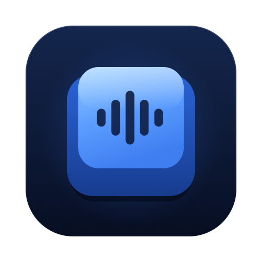

<p align="center"></p>

<h1 align="center">Keytone</h1>
<p align="center">Приятный звук механической клавиатуры и мыши для macOS. Живёт в строке меню.</p>

<p align="center">
  <a href="../../releases/latest/download/Keytone.zip"><b>Скачать для macOS</b></a>
</p>

## Возможности

- Пять встроенных паков с реальными записями свитчей, свой звук нажатия и отпускания для каждой клавиши
- Звуки мыши: левая и правая кнопки, колесо (отключается отдельно)
- Разброс тона и стерео-панорама по положению клавиши
- Импорт паков [Mechvibes](https://mechvibes.com) (v1 и v2, папка или `.zip`)
- Нативное приложение на Swift / SwiftUI / AVAudioEngine, без задержки
- Ничего не записывает и никуда не отправляет

## Установка

1. Скачайте `Keytone.zip` со [страницы релизов](../../releases/latest) и распакуйте.
2. Перенесите `Keytone.app` в «Программы».
3. Первый запуск: macOS предупредит, что разработчик не проверен. Откройте «Системные настройки → Конфиденциальность и безопасность» и нажмите «Всё равно открыть» (на macOS 14 также работает правый клик → «Открыть»). Приложение не подписано сертификатом Apple.
4. Разрешите доступ: «Конфиденциальность и безопасность → Мониторинг ввода» → включите Keytone.

Требования: macOS 14 и новее, Apple Silicon или Intel.

## Сборка из исходников

Нужен Xcode (полный, не только Command Line Tools).

```bash
./build.sh            # Keytone.app + Keytone.zip
VERSION=1.1.0 ./build.sh
```

Иконка рендерится из `Assets/logo.svg`:

```bash
swift Assets/make_icon.swift
```

`build.sh` подписывает приложение локальным сертификатом `Keytone Local Signing`, если он есть в связке ключей (тогда разрешение «Мониторинг ввода» не слетает после пересборки), иначе — ad-hoc.

## Структура

| Путь | Что там |
|---|---|
| `Sources/Keytone/Input.swift` | глобальный listen-only event tap (клавиатура, мышь) |
| `Sources/Keytone/Audio.swift` | полифонический плеер, загрузка и нарезка аудио |
| `Sources/Keytone/Packs.swift` | паки Mechvibes v1/v2, встроенные паки, звуки мыши |
| `Sources/Keytone/MenuUI.swift` | интерфейс в строке меню |
| `Packs/` | встроенные звуковые паки |
| `docs/` | сайт (GitHub Pages) |

## Лицензия

Код — MIT, см. [LICENSE](LICENSE).
Звуковые паки в `Packs/` принадлежат их авторам и используются с их разрешения; на них лицензия MIT не распространяется.
